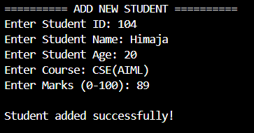
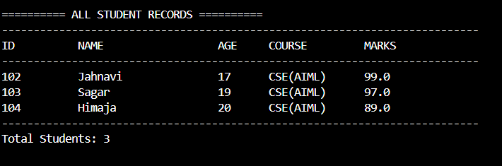
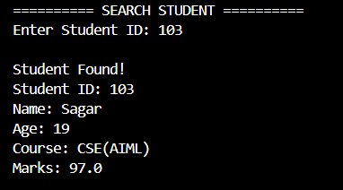
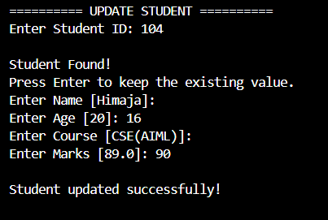
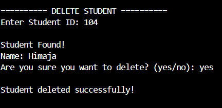
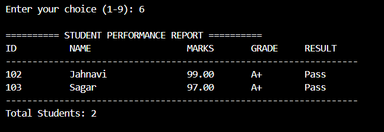
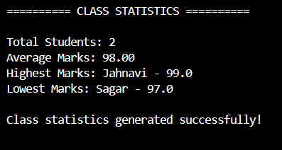
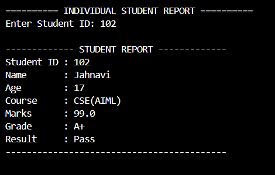
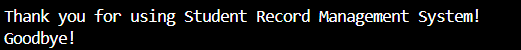

# 🎓 Student Record Management System

A Python-based Student Record Management System developed as part of the Python Programming Internship at Cognevance Technologies.

This application helps manage student information efficiently through a menu-driven interface. It supports adding, viewing, searching, updating, and deleting student records, along with generating academic performance reports and class statistics.

---

## 📌 Project Information

- **Project Name:** Student Record Management System
- **Organization:** Cognevance Technologies
- **Internship:** Python Programming Internship
- **Project Level:** Level 1 - Easy
- **Programming Language:** Python
- **Data Storage:** JSON
- **IDE:** Visual Studio Code

---

## 🚀 Features

### 1. Student Management (CRUD Operations)

- Add new student records.
- View all registered students.
- Search students using Student ID.
- Update existing student information.
- Delete student records with confirmation.

### 2. Student Performance Reports

- Calculate student grades based on marks.
- Display student-wise performance reports.
- Show Pass/Fail results.
- Generate individual student reports.

### 3. Class Statistics

- Calculate average marks.
- Identify the highest-scoring student.
- Identify the lowest-scoring student.
- Display the total number of students.

### 4. Data Management

- Store student information in JSON format.
- Automatically load saved student records.
- Maintain records between application sessions.
- Handle file-related errors.

### 5. Input Validation

- Prevent duplicate Student IDs.
- Validate student age.
- Validate marks between 0 and 100.
- Handle invalid numeric inputs.
- Prevent empty names and course details.

---

## 🛠️ Technologies Used

| Technology | Purpose |
|---|---|
| Python 3 | Core programming language |
| JSON | Student data storage |
| File Handling | Reading and writing records |
| VS Code | Development environment |

---

## 📂 Project Structure

```text
cognevance_student_record_management/
│
├── __pycache__/
│
├── data/
│   └── students.json
│
├── screenshots/
│   ├── Add_student.png
│   ├── All_records.png
│   ├── Class_statistics.png
│   ├── Delete_student.png
│   ├── Exit_message.png
│   ├── Individual_student_report.png
│   ├── Search_student.png
│   ├── Student_performance_report.png
│   └── update_student.png
│
├── file_handler.py
├── main.py
├── reports.py
├── student.py
│
└── README.md
```

---

## ⚙️ Installation and Setup

### Step 1: Install Python

Download and install Python 3 from:

https://www.python.org/downloads/

Verify the installation:

```bash
python --version
```

On Windows, you can also use:

```powershell
py --version
```

### Step 2: Clone the Repository

```bash
git clone YOUR_GITHUB_REPOSITORY_URL
```

### Step 3: Open the Project Folder

Open the downloaded project folder in Visual Studio Code.

### Step 4: Run the Application

Open the integrated terminal and execute:

```powershell
py main.py
```

---

## 🖥️ Application Menu

The application provides the following menu options:

```text
=============================================
       STUDENT RECORD MANAGEMENT SYSTEM
=============================================

1. Add Student
2. View All Students
3. Search Student
4. Update Student
5. Delete Student
6. Student Performance Report
7. Class Statistics
8. Individual Student Report
9. Exit

Enter your choice (1-9):
```

---

## 📸 Project Screenshots

Screenshots of the application are available in the `screenshots` folder.

### Add Student


### View All Student Records


### Search Student


### Update Student


### Delete Student


### Student Performance Report


### Class Statistics


### Individual Student Report


### Exit Message


---

## 📊 Sample Student Data

| Student ID | Name | Age | Course | Marks |
|---|---|---:|---|---:|
| STU001 | Rahul Sharma | 20 | BCA | 95 |
| STU002 | Priya Singh | 21 | BSc | 82 |
| STU003 | Aman Kumar | 19 | BCA | 45 |
| STU004 | Neha Verma | 20 | BTech | 75 |

---

## 🎯 Learning Outcomes

Through this project, I practiced:

- Python functions and modules.
- Lists and dictionaries.
- Conditional statements and loops.
- File handling using JSON.
- Exception handling.
- CRUD operations.
- Data validation.
- Basic data analysis.
- Modular programming.

---

## 🔮 Future Improvements

- Add a graphical user interface (GUI).
- Integrate an SQLite database.
- Add student login and authentication.
- Export reports to PDF.
- Add graphical performance analytics.

---

## 👨‍💻 Author
Kondisetty Jahnavi

**Python Programming Intern**

**Cognevance Technologies**

---

## 📄 License

This project was developed for educational and internship purposes.
